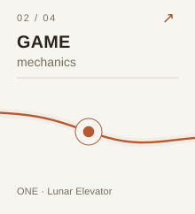
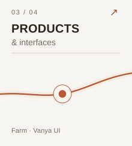
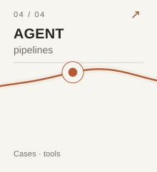

<a href="https://vanya-arc.dev"><strong>My story ↗</strong></a> &nbsp; · &nbsp; <a href="https://ui.vanya-arc.dev"><strong>Design system ↗</strong></a> &nbsp; · &nbsp; <a href="README.md" title="Русская версия"><strong>RU</strong></a>

# Hi, I'm Vanya

I spent 14 years writing code, five of them at Yandex. These days I work on my own projects, from a digital campfire for facilitated group conversations to an AI agent harness.

### Pick a direction

<a href="#narrative-and-meaning" title="Narrative and meaning"><picture><source media="(prefers-color-scheme: dark)" srcset="assets/wave-01-stories-en-dark.svg" /></picture></a><a href="#game-mechanics" title="Game mechanics"><picture><source media="(prefers-color-scheme: dark)" srcset="assets/wave-02-games-en-dark.svg" /></picture></a><a href="#products-and-interfaces" title="Products and interfaces"><picture><source media="(prefers-color-scheme: dark)" srcset="assets/wave-03-products-en-dark.svg" /></picture></a><a href="#agent-pipelines" title="Agent pipelines"><picture><source media="(prefers-color-scheme: dark)" srcset="assets/wave-04-agents-en-dark.svg" /></picture></a>

## Narrative and meaning

I make interactive stories about my life, explore how narrative helps make sense of things, and build digital spaces for communities.

- **[Sine Wave](https://vanya-arc.dev)** — my personal timeline, with years to explore and moments to open.
- **[Fireplace](https://github.com/VanDalkvist/fireplace)** — I built a digital campfire and facilitated a meeting where people's words appeared around the flames.
- **[Dependency Inversion](https://ioc.vanya-arc.dev)** — interactive films about software design patterns.

## Game mechanics

I've experimented with game rules in a Telegram app for students, a tabletop RPG with my daughter, and video-game prototypes. Now I'm designing games around collective consciousness.

- **ONE** — everyone looks after a single creature together. In development.
- **Lunar Elevator** — a collective construction project stretching from Earth to the Moon. In development.
- **[Student mini app](https://vanya-arc.dev/?open=first-money-gamification-app-2025-08)** — teams, challenges, points, and prizes inside Telegram.
- **[Ashen Grove](https://github.com/VanDalkvist/ashen-grove-rpg)** — an isometric RPG prototype with a map, quests, and a playable character.

## Products and interfaces

The Farm is still private. The design system and a few tools for my workspace are already available on GitHub.

- **Farm** — where I keep track of my projects and experiments. I want to gradually open it up as a public workshop.
- **[Vanya UI](https://ui.vanya-arc.dev)** — shared components I use to build interfaces for my projects.
- **[BB References](https://github.com/VanDalkvist/bb-plugin-references)** — visual references and notes inside the BB workspace.

What's inside the Farm right now?

A workspace for active projects and ideas I've put on hold. In the public version, I'd like to show the work as it happens, not just the finished results.

## Agent pipelines

In one pipeline, an LLM reads supplier price lists, code matches items against a catalog, and a person checks uncertain matches. I'm also building tools for software development and for the agents themselves.

- **[Kozhanye Meshki](https://meatbags.ru)** — an AI automation studio I built with a partner. Projects include processing supplier price lists and legal documents.
- **[Durable Zero](https://github.com/VanDalkvist/durable-zero)** — an experimental agent harness with persistent sessions.
- **[Arch Rules](https://github.com/ai-meatbags/arch-rules)** and **[Skills](https://github.com/VanDalkvist/arch-rules-skills)** — architecture rules and skills to help agents use them while coding.
- **[Pi GBrain](https://github.com/VanDalkvist/pi-gbrain)** — GBrain memory integration for the Pi agent.

How the supplier price-list pipeline works

The model extracts products and prices from supplier messages. Code matches them to the catalog. A person reviews new or ambiguous entries, and confirmed matches are saved for future price lists.

---

[All public repositories](https://github.com/VanDalkvist?tab=repositories)
