
<a href="https://vanya-arc.dev"><strong>My story ↗</strong></a> &nbsp; · &nbsp; <a href="https://ui.vanya-arc.dev"><strong>Design system ↗</strong></a> &nbsp; · &nbsp; <a href="README.md" title="Русская версия"><strong>RU</strong></a>

# Hi, I'm Vanya

I spent 14 years writing code, five of them at Yandex. These days I work on my own projects, from a digital campfire for facilitated group conversations to an AI agent harness.

### Pick a direction

<a href="#narrative-and-meaning" title="Narrative and meaning"><picture><source media="(prefers-color-scheme: dark)" srcset="assets/wave-01-stories-en-v5-dark.svg" /></picture></a><a href="#game-mechanics" title="Game mechanics"><picture><source media="(prefers-color-scheme: dark)" srcset="assets/wave-02-games-en-v5-dark.svg" /></picture></a><a href="#products-and-interfaces" title="Products and interfaces"><picture><source media="(prefers-color-scheme: dark)" srcset="assets/wave-03-products-en-v5-dark.svg" /></picture></a><a href="#agent-pipelines" title="Agent pipelines"><picture><source media="(prefers-color-scheme: dark)" srcset="assets/wave-04-agents-en-v5-dark.svg" /></picture></a>

## Narrative and meaning

I started with personal websites, including one about my relationship with my wife. Later came an interactive birthday gift for a friend. In Fireplace, people's words appeared around a shared digital fire during a group conversation.

<a href="https://vanya-arc.dev" title="Sine Wave"><picture><source media="(prefers-color-scheme: dark)" srcset="assets/card-sine-en-v1-dark.svg" /></picture></a><a href="https://github.com/VanDalkvist/fireplace" title="Fireplace"><picture><source media="(prefers-color-scheme: dark)" srcset="assets/card-fireplace-en-v1-dark.svg" /></picture></a><picture><source media="(prefers-color-scheme: dark)" srcset="assets/card-kirill-en-v1-dark.svg" /></picture>

Also: [Dependency Inversion](https://ioc.vanya-arc.dev) — an interactive film about software architecture; **Dynamics** — drafts for facilitated group sessions.

## Game mechanics

I've tried different game loops: an RPG where conversations change the world, a platformer that earns tokens, and a simulation where AI agents gather resources for a shared megaproject.

<picture><source media="(prefers-color-scheme: dark)" srcset="assets/card-stairwell-en-v1-dark.svg" /></picture><picture><source media="(prefers-color-scheme: dark)" srcset="assets/card-banana-en-v1-dark.svg" /></picture><a href="https://github.com/VanDalkvist/ai_world" title="AI World"><picture><source media="(prefers-color-scheme: dark)" srcset="assets/card-ai-world-en-v1-dark.svg" /></picture></a>

Also: a [student mini app](https://vanya-arc.dev/?open=first-money-gamification-app-2025-08) with teams, challenges and points; **City of Skills** — tabletop story cards with choices and consequences, made for a game with my daughter.

## Products and interfaces

The Farm is still private: it's where I keep my projects and experiments. I've already published the design system and some tools for my workspace.

<picture><source media="(prefers-color-scheme: dark)" srcset="assets/card-farm-en-v1-dark.svg" /></picture><a href="https://ui.vanya-arc.dev" title="Vanya UI"><picture><source media="(prefers-color-scheme: dark)" srcset="assets/card-vanya-ui-en-v1-dark.svg" /></picture></a><a href="https://github.com/VanDalkvist/bb-plugin-references" title="BB References"><picture><source media="(prefers-color-scheme: dark)" srcset="assets/card-bb-references-en-v1-dark.svg" /></picture></a>

What's inside the Farm right now?

A workspace for active projects and ideas I've put on hold. In the public version, I'd like to show the work as it happens, not just the finished results.

## Agent pipelines

In one pipeline, an LLM reads supplier price lists, code matches items against a catalog, and a person checks uncertain matches. I'm also building tools for developers and for the agents themselves.

<a href="https://meatbags.ru" title="Kozhanye Meshki"><picture><source media="(prefers-color-scheme: dark)" srcset="assets/card-meatbags-en-v1-dark.svg" /></picture></a><a href="https://github.com/VanDalkvist/durable-zero" title="Durable Zero"><picture><source media="(prefers-color-scheme: dark)" srcset="assets/card-durable-zero-en-v1-dark.svg" /></picture></a><a href="https://github.com/ai-meatbags/arch-rules" title="Arch Rules"><picture><source media="(prefers-color-scheme: dark)" srcset="assets/card-arch-rules-en-v1-dark.svg" /></picture></a>

Also: [Arch Rules Skills](https://github.com/VanDalkvist/arch-rules-skills) — helping agents apply architecture rules; [Pi GBrain](https://github.com/VanDalkvist/pi-gbrain) — memory for Pi.

How the supplier price-list pipeline works

The model extracts products and prices from supplier messages. Code matches them to the catalog. A person reviews new or ambiguous entries, and confirmed matches are saved for future price lists.

---

[All public repositories](https://github.com/VanDalkvist?tab=repositories)
