<a href="https://vanya-arc.dev"><strong>My story ↗</strong></a> &nbsp; · &nbsp; <a href="https://ui.vanya-arc.dev"><strong>Design system ↗</strong></a> &nbsp; · &nbsp; <a href="README.md" title="Русская версия"><strong>RU</strong></a>

# Hi, I'm Vanya

I spent 14 years writing code, five of them at Yandex. These days I work on my own projects, from a digital campfire for facilitated group conversations to an AI agent harness.

<a href="#narrative-and-meaning" title="Narrative and meaning"><picture><source media="(prefers-color-scheme: dark)" srcset="assets/wave-01-stories-en-v5-dark.svg" /></picture></a><a href="#game-mechanics" title="Game mechanics"><picture><source media="(prefers-color-scheme: dark)" srcset="assets/wave-02-games-en-v5-dark.svg" /></picture></a><a href="#products-and-interfaces" title="Products and interfaces"><picture><source media="(prefers-color-scheme: dark)" srcset="assets/wave-03-products-en-v5-dark.svg" /></picture></a><a href="#agent-pipelines" title="Agent pipelines"><picture><source media="(prefers-color-scheme: dark)" srcset="assets/wave-04-agents-en-v5-dark.svg" /></picture></a> <a href="https://vanya-arc.dev" title="Sine Wave"><picture><source media="(prefers-color-scheme: dark)" srcset="assets/seamless-stories-en-v2-tile-1-dark.svg" /></picture></a><a href="https://github.com/VanDalkvist/fireplace" title="Fireplace"><picture><source media="(prefers-color-scheme: dark)" srcset="assets/seamless-stories-en-v2-tile-2-dark.svg" /></picture></a><picture><source media="(prefers-color-scheme: dark)" srcset="assets/seamless-stories-en-v2-tile-3-dark.svg" /></picture><a href="https://ioc.vanya-arc.dev" title="Dependency Inversion"><picture><source media="(prefers-color-scheme: dark)" srcset="assets/seamless-stories-en-v2-tile-4-dark.svg" /></picture></a> <picture><source media="(prefers-color-scheme: dark)" srcset="assets/seamless-games-en-v2-tile-1-dark.svg" /></picture><picture><source media="(prefers-color-scheme: dark)" srcset="assets/seamless-games-en-v2-tile-2-dark.svg" /></picture><a href="https://github.com/VanDalkvist/ai_world" title="AI World"><picture><source media="(prefers-color-scheme: dark)" srcset="assets/seamless-games-en-v2-tile-3-dark.svg" /></picture></a><picture><source media="(prefers-color-scheme: dark)" srcset="assets/seamless-games-en-v2-tile-4-dark.svg" /></picture> <picture><source media="(prefers-color-scheme: dark)" srcset="assets/seamless-products-en-v2-tile-1-dark.svg" /></picture><a href="https://ui.vanya-arc.dev" title="Vanya UI"><picture><source media="(prefers-color-scheme: dark)" srcset="assets/seamless-products-en-v2-tile-2-dark.svg" /></picture></a><a href="https://github.com/VanDalkvist/bb-plugin-references" title="BB References"><picture><source media="(prefers-color-scheme: dark)" srcset="assets/seamless-products-en-v2-tile-3-dark.svg" /></picture></a><picture><source media="(prefers-color-scheme: dark)" srcset="assets/seamless-products-en-v2-tile-4-dark.svg" /></picture> <a href="https://zero.vanya-arc.dev/" title="Zero"><picture><source media="(prefers-color-scheme: dark)" srcset="assets/seamless-agents-en-v2-tile-1-dark.svg" /></picture></a><a href="https://github.com/VanDalkvist/durable-zero" title="Durable Zero"><picture><source media="(prefers-color-scheme: dark)" srcset="assets/seamless-agents-en-v2-tile-2-dark.svg" /></picture></a><a href="https://github.com/ai-meatbags/arch-rules" title="Arch Rules"><picture><source media="(prefers-color-scheme: dark)" srcset="assets/seamless-agents-en-v2-tile-3-dark.svg" /></picture></a><a href="https://meatbags.ru" title="Kozhanye Meshki"><picture><source media="(prefers-color-scheme: dark)" srcset="assets/seamless-agents-en-v2-tile-4-dark.svg" /></picture></a>

---

[All public repositories](https://github.com/VanDalkvist?tab=repositories)
