
<picture><source media="(prefers-color-scheme: dark)" srcset="assets/nav-en-v2-1-dark.svg" /></picture><a href="https://vanya-arc.dev" title=""><picture><source media="(prefers-color-scheme: dark)" srcset="assets/nav-en-v2-2-dark.svg" /></picture></a><a href="https://ui.vanya-arc.dev" title=""><picture><source media="(prefers-color-scheme: dark)" srcset="assets/nav-en-v2-3-dark.svg" /></picture></a><a href="README.md" title=""><picture><source media="(prefers-color-scheme: dark)" srcset="assets/nav-en-v2-4-dark.svg" /></picture></a>  <a href="#narrative-and-meaning" title="Narrative and meaning"><picture><source media="(prefers-color-scheme: dark)" srcset="assets/wave-01-stories-en-v6-dark.svg" /></picture></a><a href="#game-mechanics" title="Game mechanics"><picture><source media="(prefers-color-scheme: dark)" srcset="assets/wave-02-games-en-v6-dark.svg" /></picture></a><a href="#products-and-interfaces" title="Products and interfaces"><picture><source media="(prefers-color-scheme: dark)" srcset="assets/wave-03-products-en-v6-dark.svg" /></picture></a><a href="#agent-pipelines" title="Agent pipelines"><picture><source media="(prefers-color-scheme: dark)" srcset="assets/wave-04-agents-en-v6-dark.svg" /></picture></a> <a href="https://vanya-arc.dev" title="Sine Wave"><picture><source media="(prefers-color-scheme: dark)" srcset="assets/seamless-stories-en-v8-tile-1-dark.svg" /></picture></a><a href="https://github.com/VanDalkvist/fireplace" title="Fireplace"><picture><source media="(prefers-color-scheme: dark)" srcset="assets/seamless-stories-en-v8-tile-2-dark.svg" /></picture></a><a href="https://ui.vanya-arc.dev" title="Vanya UI"><picture><source media="(prefers-color-scheme: dark)" srcset="assets/seamless-stories-en-v8-tile-3-dark.svg" /></picture></a><a href="https://ioc.vanya-arc.dev" title="IOC Film"><picture><source media="(prefers-color-scheme: dark)" srcset="assets/seamless-stories-en-v8-tile-4-dark.svg" /></picture></a> <picture><source media="(prefers-color-scheme: dark)" srcset="assets/seamless-games-en-v8-tile-1-dark.svg" /></picture><picture><source media="(prefers-color-scheme: dark)" srcset="assets/seamless-games-en-v8-tile-2-dark.svg" /></picture><a href="https://github.com/VanDalkvist/ai_world" title="AI World"><picture><source media="(prefers-color-scheme: dark)" srcset="assets/seamless-games-en-v8-tile-3-dark.svg" /></picture></a><a href="https://skillcity-cards-play.lovable.app/" title="City of Skills"><picture><source media="(prefers-color-scheme: dark)" srcset="assets/seamless-games-en-v8-tile-4-dark.svg" /></picture></a> <a href="https://vanya-arc.dev/?t=1755505592879&amp;z=45.087&amp;open=shotgun-pro-joined-2025-09" title="ShotgunPro"><picture><source media="(prefers-color-scheme: dark)" srcset="assets/seamless-products-en-v8-tile-1-dark.svg" /></picture></a><a href="https://vanya-arc.dev/?open=first-money-gamification-app-2025-08" title="TG game-app"><picture><source media="(prefers-color-scheme: dark)" srcset="assets/seamless-products-en-v8-tile-2-dark.svg" /></picture></a><a href="https://meatbags.ru" title="Kozhanye Meshki"><picture><source media="(prefers-color-scheme: dark)" srcset="assets/seamless-products-en-v8-tile-3-dark.svg" /></picture></a><picture><source media="(prefers-color-scheme: dark)" srcset="assets/seamless-products-en-v8-tile-4-dark.svg" /></picture> <a href="https://zero.vanya-arc.dev/" title="Zero"><picture><source media="(prefers-color-scheme: dark)" srcset="assets/seamless-agents-en-v8-tile-1-dark.svg" /></picture></a><a href="https://github.com/VanDalkvist/durable-zero" title="Durable Zero"><picture><source media="(prefers-color-scheme: dark)" srcset="assets/seamless-agents-en-v8-tile-2-dark.svg" /></picture></a><a href="https://github.com/ai-meatbags/arch-rules" title="Arch Rules"><picture><source media="(prefers-color-scheme: dark)" srcset="assets/seamless-agents-en-v8-tile-3-dark.svg" /></picture></a><a href="https://github.com/VanDalkvist/arch-improvement-skills" title="Arch Loop"><picture><source media="(prefers-color-scheme: dark)" srcset="assets/seamless-agents-en-v8-tile-4-dark.svg" /></picture></a>

