<a href="https://vanya-arc.dev"><strong>Моя история ↗</strong></a> &nbsp; · &nbsp; <a href="https://ui.vanya-arc.dev"><strong>Дизайн-система ↗</strong></a> &nbsp; · &nbsp; <a href="README.en.md" title="English version"><strong>EN</strong></a>

# Привет, я Ваня

14 лет я писал код, 5 из них — в Яндексе. Сейчас делаю свои проекты: от цифрового костра для фасилитации встреч до агентского харнесса.

### С какой стороны посмотреть?

<a href="#нарратив-и-смыслы" title="Нарратив и смыслы"><picture><source media="(prefers-color-scheme: dark)" srcset="assets/wave-01-stories-ru-v5-dark.svg" /></picture></a><a href="#игровые-механики" title="Игровые механики"><picture><source media="(prefers-color-scheme: dark)" srcset="assets/wave-02-games-ru-v5-dark.svg" /></picture></a><a href="#продукты-и-интерфейсы" title="Продукты и интерфейсы"><picture><source media="(prefers-color-scheme: dark)" srcset="assets/wave-03-products-ru-v5-dark.svg" /></picture></a><a href="#агентские-пайплайны" title="Агентские пайплайны"><picture><source media="(prefers-color-scheme: dark)" srcset="assets/wave-04-agents-ru-v5-dark.svg" /></picture></a>

## Нарратив и смыслы

Когда-то сделал сайт о нашей истории с женой, позже — интерактивный подарок Кириллу. В «Костре» слова участников встречи появлялись вокруг общего огня.

<a href="https://vanya-arc.dev" title="Синусоида"><picture><source media="(prefers-color-scheme: dark)" srcset="assets/card-sine-ru-v1-dark.svg" /></picture></a><a href="https://github.com/VanDalkvist/fireplace" title="Костёр"><picture><source media="(prefers-color-scheme: dark)" srcset="assets/card-fireplace-ru-v1-dark.svg" /></picture></a><picture><source media="(prefers-color-scheme: dark)" srcset="assets/card-kirill-ru-v1-dark.svg" /></picture>

Ещё: [Инверсия зависимостей](https://ioc.vanya-arc.dev) — интерактивный фильм об архитектуре программ; **Dynamics** — черновики сценариев групповых встреч.

## Игровые механики

Пробовал разные игровые циклы: RPG, где разговор меняет мир; платформер с заработком токенов; симуляцию, в которой AI-агенты собирают ресурсы для общей стройки.

<picture><source media="(prefers-color-scheme: dark)" srcset="assets/card-stairwell-ru-v1-dark.svg" /></picture><picture><source media="(prefers-color-scheme: dark)" srcset="assets/card-banana-ru-v1-dark.svg" /></picture><a href="https://github.com/VanDalkvist/ai_world" title="AI World"><picture><source media="(prefers-color-scheme: dark)" srcset="assets/card-ai-world-ru-v1-dark.svg" /></picture></a>

Ещё: [студенческий миниапп](https://vanya-arc.dev/?open=first-money-gamification-app-2025-08) с командами, заданиями и баллами; **Город навыков** — карточки ситуаций, выборов и последствий для настольной игры с дочкой.

## Продукты и интерфейсы

Ферма пока приватная: там я веду проекты и эксперименты. Дизайн-систему и отдельные инструменты для рабочей среды уже выложил.

<picture><source media="(prefers-color-scheme: dark)" srcset="assets/card-farm-ru-v1-dark.svg" /></picture><a href="https://ui.vanya-arc.dev" title="Vanya UI"><picture><source media="(prefers-color-scheme: dark)" srcset="assets/card-vanya-ui-ru-v1-dark.svg" /></picture></a><a href="https://github.com/VanDalkvist/bb-plugin-references" title="BB References"><picture><source media="(prefers-color-scheme: dark)" srcset="assets/card-bb-references-ru-v1-dark.svg" /></picture></a>

Что сейчас есть в Ферме

Рабочий стол, активные проекты и те, что я отложил. В публичной версии хочу показывать, как идёт работа, а не только готовые результаты.

## Агентские пайплайны

В одном из пайплайнов модель разбирает прайс, код ищет товары в каталоге, а человек проверяет спорные совпадения. Параллельно собираю инструменты для разработчиков и самих агентов.

<a href="https://meatbags.ru" title="Кожаные мешки"><picture><source media="(prefers-color-scheme: dark)" srcset="assets/card-meatbags-ru-v1-dark.svg" /></picture></a><a href="https://github.com/VanDalkvist/durable-zero" title="Durable Zero"><picture><source media="(prefers-color-scheme: dark)" srcset="assets/card-durable-zero-ru-v1-dark.svg" /></picture></a><a href="https://github.com/ai-meatbags/arch-rules" title="Arch Rules"><picture><source media="(prefers-color-scheme: dark)" srcset="assets/card-arch-rules-ru-v1-dark.svg" /></picture></a>

Ещё: [Arch Rules Skills](https://github.com/VanDalkvist/arch-rules-skills) — применение правил при работе с агентами; [Pi GBrain](https://github.com/VanDalkvist/pi-gbrain) — память для Pi.

Как устроен пайплайн с прайсами

Модель достаёт товары и цены из сообщений поставщиков. Код ищет соответствия в каталоге. Новые и неоднозначные позиции проверяет человек, а подтверждённые соответствия сохраняются для следующих прайсов.

---

[Все публичные репозитории](https://github.com/VanDalkvist?tab=repositories)
