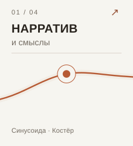
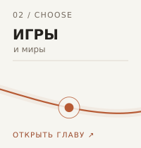
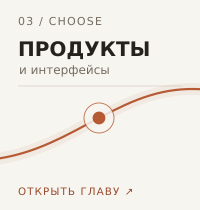
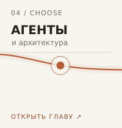

<a href="https://vanya-arc.dev"><strong>Моя история ↗</strong></a> &nbsp; · &nbsp; <a href="https://ui.vanya-arc.dev"><strong>Дизайн-система ↗</strong></a>

# Привет, я Ваня

14 лет я писал код, 5 из них — в Яндексе. Сейчас делаю свои проекты: от цифрового костра для фасилитации встреч до агентского харнесса.

### С какой стороны посмотреть?

<a href="#нарратив-и-смыслы" title="Нарратив и смыслы"><picture><source media="(prefers-color-scheme: dark)" srcset="assets/wave-01-stories-dark.svg" /></picture></a><a href="#игровые-механики" title="Игровые механики"><picture><source media="(prefers-color-scheme: dark)" srcset="assets/wave-02-games-dark.svg" /></picture></a><a href="#продукты-и-интерфейсы" title="Продукты и интерфейсы"><picture><source media="(prefers-color-scheme: dark)" srcset="assets/wave-03-products-dark.svg" /></picture></a><a href="#агентские-пайплайны" title="Агентские пайплайны"><picture><source media="(prefers-color-scheme: dark)" srcset="assets/wave-04-agents-dark.svg" /></picture></a>

## Нарратив и смыслы

Делаю интерактивные истории о своей жизни, накручиваю нарративы вокруг смыслов, создаю цифровые пространства для сообществ.

- **[Синусоида](https://vanya-arc.dev)** — мой путь, можно ходить по годам и открывать события
- **[Костёр](https://github.com/VanDalkvist/fireplace)** — смастерил и провёл встречу, во время которой слова участников появлялись вокруг огня
- **[Инверсия зависимостей](https://ioc.vanya-arc.dev)** — интерактивные фильмы про паттерны проектирования

## Игровые механики

Игровые правила пробовал в студенческом Telegram-приложении, настольной RPG с дочкой и прототипах компьютерных игр. Сейчас проектирую игры для коллективного сознания

- **ONE** — участники вместе заботятся об одном существе. Пока на стадии разработки.
- **Лунный лифт** — общая стройка от Земли до Луны. Пока на стадии разработки.
- **[Студенческий миниапп](https://vanya-arc.dev/?open=first-money-gamification-app-2025-08)** — команды, задания, баллы и призы внутри Telegram.
- **[Тлеющая роща](https://github.com/VanDalkvist/ashen-grove-rpg)** — изометрический RPG-прототип: карта, квесты, персонаж.

## Продукты и интерфейсы

Ферму пока вижу только я. А вот дизайн-система и отдельные инструменты для рабочей среды уже доступны на GitHub.

- **Ферма** — рабочее место для моих проектов и экспериментов. Постепенно хочу открыть его как мастерскую.
- **[Vanya UI](https://ui.vanya-arc.dev)** — общие компоненты, из которых собираю интерфейсы своих проектов.
- **[BB References](https://github.com/VanDalkvist/bb-plugin-references)** — визуальные референсы и заметки прямо в рабочем пространстве BB.

Что сейчас есть в Ферме

Рабочий стол, активные проекты и те, что я отложил. В публичной версии хочу показывать, как идёт работа, а не только готовые результаты.

## Агентские пайплайны

В одном из пайплайнов нейросеть разбирает прайс, код сверяет товары с каталогом, а человек подтверждает спорные позиции. Параллельно собираю инструменты для разработки и работы самих агентов.

- **[Кожаные мешки](https://meatbags.ru)** — AI-ателье, которое мы делали с партнёром. Среди проектов — обработка прайсов и юридических документов.
- **[Durable Zero](https://github.com/VanDalkvist/durable-zero)** — экспериментальный агентский харнесс с сохранением сессий.
- **[Arch Rules](https://github.com/ai-meatbags/arch-rules)** и **[Skills](https://github.com/VanDalkvist/arch-rules-skills)** — архитектурные правила и навыки, чтобы агенты применяли их в работе.
- **[Pi GBrain](https://github.com/VanDalkvist/pi-gbrain)** — подключение памяти GBrain к агенту Pi.

Как устроен пайплайн с прайсами

Модель достаёт товары и цены из сообщений поставщиков. Код ищет соответствия в каталоге. Новые и неоднозначные позиции проверяет человек, а подтверждённые соответствия сохраняются для следующих прайсов.

---

[Все публичные репозитории](https://github.com/VanDalkvist?tab=repositories)
