
<a href="https://vanya-arc.dev"><strong>Моя история ↗</strong></a> &nbsp; · &nbsp; <a href="https://ui.vanya-arc.dev"><strong>Дизайн-система ↗</strong></a> &nbsp; · &nbsp; <a href="README.en.md" title="English version"><strong>EN</strong></a>

# Привет, я Ваня

14 лет я писал код, 5 из них — в Яндексе. Сейчас делаю свои проекты: от цифрового костра для фасилитации встреч до агентского харнесса.

<a href="#нарратив-и-смыслы" title="Нарратив и смыслы"><picture><source media="(prefers-color-scheme: dark)" srcset="assets/wave-01-stories-ru-v5-dark.svg" /></picture></a><a href="#игровые-механики" title="Игровые механики"><picture><source media="(prefers-color-scheme: dark)" srcset="assets/wave-02-games-ru-v5-dark.svg" /></picture></a><a href="#продукты-и-интерфейсы" title="Продукты и интерфейсы"><picture><source media="(prefers-color-scheme: dark)" srcset="assets/wave-03-products-ru-v5-dark.svg" /></picture></a><a href="#агентские-пайплайны" title="Агентские пайплайны"><picture><source media="(prefers-color-scheme: dark)" srcset="assets/wave-04-agents-ru-v5-dark.svg" /></picture></a>

<picture><source media="(prefers-color-scheme: dark)" srcset="assets/gallery-stories-ru-v1-header-dark.svg" /></picture> <a href="https://vanya-arc.dev" title="Синусоида"><picture><source media="(prefers-color-scheme: dark)" srcset="assets/gallery-stories-ru-v1-tile-1-dark.svg" /></picture></a><a href="https://github.com/VanDalkvist/fireplace" title="Костёр"><picture><source media="(prefers-color-scheme: dark)" srcset="assets/gallery-stories-ru-v1-tile-2-dark.svg" /></picture></a><picture><source media="(prefers-color-scheme: dark)" srcset="assets/gallery-stories-ru-v1-tile-3-dark.svg" /></picture><a href="https://ioc.vanya-arc.dev" title="Инверсия зависимостей"><picture><source media="(prefers-color-scheme: dark)" srcset="assets/gallery-stories-ru-v1-tile-4-dark.svg" /></picture></a>

<picture><source media="(prefers-color-scheme: dark)" srcset="assets/gallery-games-ru-v1-header-dark.svg" /></picture> <picture><source media="(prefers-color-scheme: dark)" srcset="assets/gallery-games-ru-v1-tile-1-dark.svg" /></picture><picture><source media="(prefers-color-scheme: dark)" srcset="assets/gallery-games-ru-v1-tile-2-dark.svg" /></picture><a href="https://github.com/VanDalkvist/ai_world" title="AI World"><picture><source media="(prefers-color-scheme: dark)" srcset="assets/gallery-games-ru-v1-tile-3-dark.svg" /></picture></a><picture><source media="(prefers-color-scheme: dark)" srcset="assets/gallery-games-ru-v1-tile-4-dark.svg" /></picture>

<picture><source media="(prefers-color-scheme: dark)" srcset="assets/gallery-products-ru-v1-header-dark.svg" /></picture> <picture><source media="(prefers-color-scheme: dark)" srcset="assets/gallery-products-ru-v1-tile-1-dark.svg" /></picture><a href="https://ui.vanya-arc.dev" title="Vanya UI"><picture><source media="(prefers-color-scheme: dark)" srcset="assets/gallery-products-ru-v1-tile-2-dark.svg" /></picture></a><a href="https://github.com/VanDalkvist/bb-plugin-references" title="BB References"><picture><source media="(prefers-color-scheme: dark)" srcset="assets/gallery-products-ru-v1-tile-3-dark.svg" /></picture></a><picture><source media="(prefers-color-scheme: dark)" srcset="assets/gallery-products-ru-v1-tile-4-dark.svg" /></picture>

<picture><source media="(prefers-color-scheme: dark)" srcset="assets/gallery-agents-ru-v1-header-dark.svg" /></picture> <a href="https://zero.vanya-arc.dev/" title="Zero"><picture><source media="(prefers-color-scheme: dark)" srcset="assets/gallery-agents-ru-v1-tile-1-dark.svg" /></picture></a><a href="https://github.com/VanDalkvist/durable-zero" title="Durable Zero"><picture><source media="(prefers-color-scheme: dark)" srcset="assets/gallery-agents-ru-v1-tile-2-dark.svg" /></picture></a><a href="https://github.com/ai-meatbags/arch-rules" title="Arch Rules"><picture><source media="(prefers-color-scheme: dark)" srcset="assets/gallery-agents-ru-v1-tile-3-dark.svg" /></picture></a><a href="https://meatbags.ru" title="Кожаные мешки"><picture><source media="(prefers-color-scheme: dark)" srcset="assets/gallery-agents-ru-v1-tile-4-dark.svg" /></picture></a>

---

[Все публичные репозитории](https://github.com/VanDalkvist?tab=repositories)
