
<picture><source media="(prefers-color-scheme: dark)" srcset="assets/nav-ru-v1-1-dark.svg" /></picture><a href="https://vanya-arc.dev" title=""><picture><source media="(prefers-color-scheme: dark)" srcset="assets/nav-ru-v1-2-dark.svg" /></picture></a><a href="https://ui.vanya-arc.dev" title=""><picture><source media="(prefers-color-scheme: dark)" srcset="assets/nav-ru-v1-3-dark.svg" /></picture></a><a href="README.en.md" title="English version"><picture><source media="(prefers-color-scheme: dark)" srcset="assets/nav-ru-v1-4-dark.svg" /></picture></a> <picture><source media="(prefers-color-scheme: dark)" srcset="assets/identity-ru-v2-dark.svg" /></picture> <a href="#нарратив-и-смыслы" title="Нарратив и смыслы"><picture><source media="(prefers-color-scheme: dark)" srcset="assets/wave-01-stories-ru-v5-dark.svg" /></picture></a><a href="#игровые-механики" title="Игровые механики"><picture><source media="(prefers-color-scheme: dark)" srcset="assets/wave-02-games-ru-v5-dark.svg" /></picture></a><a href="#продукты-и-интерфейсы" title="Продукты и интерфейсы"><picture><source media="(prefers-color-scheme: dark)" srcset="assets/wave-03-products-ru-v5-dark.svg" /></picture></a><a href="#агентские-пайплайны" title="Агентские пайплайны"><picture><source media="(prefers-color-scheme: dark)" srcset="assets/wave-04-agents-ru-v5-dark.svg" /></picture></a> <a href="https://vanya-arc.dev" title="Синусоида"><picture><source media="(prefers-color-scheme: dark)" srcset="assets/seamless-stories-ru-v4-tile-1-dark.svg" /></picture></a><a href="https://github.com/VanDalkvist/fireplace" title="Костёр"><picture><source media="(prefers-color-scheme: dark)" srcset="assets/seamless-stories-ru-v4-tile-2-dark.svg" /></picture></a><a href="https://ui.vanya-arc.dev" title="Vanya UI"><picture><source media="(prefers-color-scheme: dark)" srcset="assets/seamless-stories-ru-v4-tile-3-dark.svg" /></picture></a><a href="https://ioc.vanya-arc.dev" title="IOC-фильм"><picture><source media="(prefers-color-scheme: dark)" srcset="assets/seamless-stories-ru-v4-tile-4-dark.svg" /></picture></a> <picture><source media="(prefers-color-scheme: dark)" srcset="assets/seamless-games-ru-v4-tile-1-dark.svg" /></picture><picture><source media="(prefers-color-scheme: dark)" srcset="assets/seamless-games-ru-v4-tile-2-dark.svg" /></picture><a href="https://github.com/VanDalkvist/ai_world" title="AI World"><picture><source media="(prefers-color-scheme: dark)" srcset="assets/seamless-games-ru-v4-tile-3-dark.svg" /></picture></a><picture><source media="(prefers-color-scheme: dark)" srcset="assets/seamless-games-ru-v4-tile-4-dark.svg" /></picture> <a href="https://vanya-arc.dev/?t=1755505592879&amp;z=45.087&amp;open=shotgun-pro-joined-2025-09" title="ShotgunPro"><picture><source media="(prefers-color-scheme: dark)" srcset="assets/seamless-products-ru-v4-tile-1-dark.svg" /></picture></a><a href="https://vanya-arc.dev/?open=first-money-gamification-app-2025-08" title="TG game-app"><picture><source media="(prefers-color-scheme: dark)" srcset="assets/seamless-products-ru-v4-tile-2-dark.svg" /></picture></a><a href="https://meatbags.ru" title="Кожаные мешки"><picture><source media="(prefers-color-scheme: dark)" srcset="assets/seamless-products-ru-v4-tile-3-dark.svg" /></picture></a><picture><source media="(prefers-color-scheme: dark)" srcset="assets/seamless-products-ru-v4-tile-4-dark.svg" /></picture> <a href="https://zero.vanya-arc.dev/" title="Zero"><picture><source media="(prefers-color-scheme: dark)" srcset="assets/seamless-agents-ru-v4-tile-1-dark.svg" /></picture></a><a href="https://github.com/VanDalkvist/durable-zero" title="Durable Zero"><picture><source media="(prefers-color-scheme: dark)" srcset="assets/seamless-agents-ru-v4-tile-2-dark.svg" /></picture></a><a href="https://github.com/ai-meatbags/arch-rules" title="Arch Rules"><picture><source media="(prefers-color-scheme: dark)" srcset="assets/seamless-agents-ru-v4-tile-3-dark.svg" /></picture></a><a href="https://github.com/VanDalkvist/arch-improvement-skills" title="Arch Loop"><picture><source media="(prefers-color-scheme: dark)" srcset="assets/seamless-agents-ru-v4-tile-4-dark.svg" /></picture></a>

